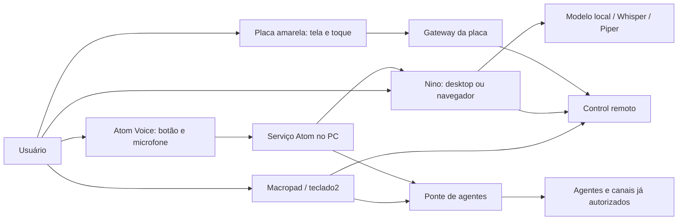

# Superhouse

O Superhouse reúne interfaces de computador, dispositivos ESP32 e integrações com o Control. O usuário pode conversar por texto ou voz, acompanhar informações na placa amarela, abrir painéis com o macropad e definir o grau de supervisão das respostas dos agentes.

O sistema é distribuído: nem tudo roda na placa ou no computador. Modelos locais, serviços do Windows, gateways de rede e serviços remotos cumprem papéis diferentes. O repositório contém os componentes disponíveis, não uma imagem completa dos servidores externos.

## Documentação

Comece pelo [manual do Superhouse](docs/README.md). Ele organiza a leitura em instalação, uso e manutenção.

| Quero entender… | Documento |
|---|---|
| Quem faz o quê e como os componentes se conectam | [Arquitetura e organogramas](docs/ARQUITETURA.md) |
| O caminho de uma pergunta, áudio, alerta ou comando | [Fluxos de funcionamento](docs/FLUXOS.md) |
| Como preparar outra máquina e instalar os dispositivos | [Instalação](docs/INSTALACAO.md) |
| Endereços, portas, configurações e credenciais | [Configuração e contratos](docs/CONFIGURACAO.md) |
| Como usar, iniciar, parar e acompanhar a autonomia | [Operação](docs/OPERACAO.md) |
| Como localizar e resolver uma falha | [Diagnóstico](docs/DIAGNOSTICO.md) |
| Como alterar, testar, atualizar e fazer backup | [Desenvolvimento e manutenção](docs/DESENVOLVIMENTO.md) |
| O que está implementado e o que ainda falta | [Estado dos componentes](docs/ESTADO-IMPLEMENTACAO.md) |

## Componentes

| Diretório | Componente |
|---|---|
| [atom2](atom2/) | Pasta reservada; sem código disponível na origem nesta importação. |
| [esp32](esp32/) | Pasta reservada; sem código disponível na origem nesta importação. |
| [espclaw](espclaw/) | Referências C do agendador e armazenamento do ESPClaw. |
| [house](house/) | Pasta reservada; vazia na origem nesta importação. |
| [nino](nino/) | Assistente com interface, voz e integrações. |
| [placaamarelajarvis](placaamarelajarvis/) | Firmware, gateway e interface da placa amarela. |
| [teclado2](teclado2/) | Atalhos globais, consulta ao Control e ajustes de autonomia. |

## Uso

Consulte as instruções de cada componente. O teclado usa módulos do Nino, e os caminhos atuais do ativador apontam para `C:\repositorio\nino` e `C:\repositorio\teclado2`. Reunir os fontes aqui não altera automaticamente esses caminhos nem a inicialização do Windows.

Esta importação reúne os arquivos atuais dos diretórios originais, incluindo alterações locais. Os históricos independentes de Nino e da placa permanecem nos respectivos repositórios originais; o histórico anterior do teclado permanece neste repositório, agora dentro de `teclado2/`.

## Arquivos locais

Credenciais, tokens, configurações privadas, documentos pessoais, bases de conhecimento, gravações, logs, dependências instaladas, modelos de IA e dumps de memória não fazem parte deste repositório. Configure as credenciais na máquina de destino e instale as dependências conforme a documentação de cada componente. Modelos e ferramentas de voz/transcrição do Nino precisam ser instalados separadamente.

`atom2`, `esp32` e `house` não tinham fontes disponíveis na cópia local no momento desta importação; seus diretórios contêm apenas a indicação dessa situação.

## Visão rápida

As setas representam rotas implementadas, não uma promessa de que todos os serviços estão instalados ou conectados. Na conversa local, o serviço Atom reutiliza o núcleo do Nino; não exige a janela Electron aberta. Consulte os diagramas detalhados para separar conversa local, Control e ponte.
