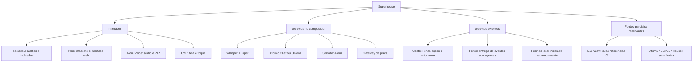
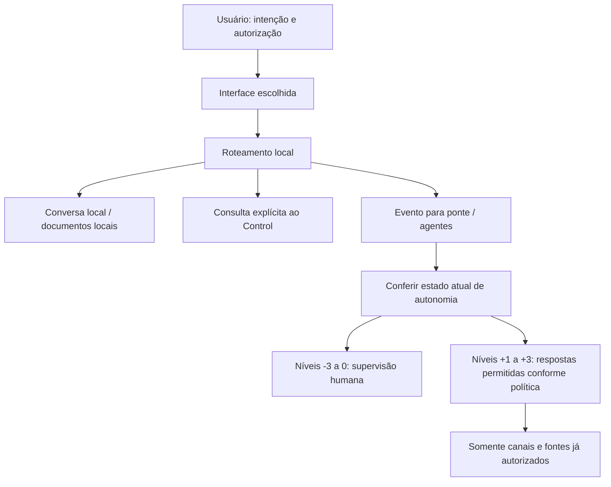
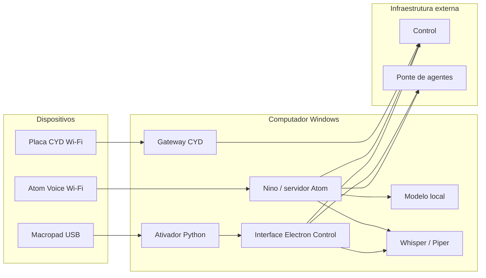

# Arquitetura e organogramas

## Objetivo e fronteiras

O Superhouse combina quatro funções: receber a intenção do usuário; obter contexto; consultar um modelo ou agente; devolver informação ou encaminhar uma ação autorizada. As interfaces são intercambiáveis em parte, mas não usam todas a mesma rota.

O macropad é um disparador de comandos. O Nino é uma interface e um núcleo de conversa. O Atom é um terminal de áudio e movimento. A placa amarela é um terminal de visualização e interação. O Control e a ponte são dependências remotas. O firmware de uma placa não executa Whisper, Piper ou o modelo de linguagem do PC.

## Organograma funcional

Hermes aparece como dependência externa ao repositório, embora sua execução seja local no Windows. Não é um serviço do Control nem é obrigatório para usar Q/T.

## Hierarquia de decisão

Este é um organograma de responsabilidade de software, não a estrutura societária das empresas. O repositório não estabelece quem administra cada empresa, não cadastra automaticamente contas e não concede novos acessos quando um nível é aumentado.

## Implantação

| Local | Processos / recursos | Depende de |
|---|---|---|
| Windows do usuário | `pythonw` do teclado; Electron; Nino; servidor Atom; gateway da placa | Sessão do usuário, dependências instaladas e permissões de áudio |
| API local de IA | Atomic Chat em `1337/v1` ou Ollama em `11434` | Modelo instalado e carregado |
| ESP32 Atom Voice | Firmware Arduino/PlatformIO; Wi-Fi; áudio; PIR | Energia, rede 2,4 GHz e servidor Atom |
| CYD | Firmware LVGL, toque e cliente de rede | Gateway/Control e configuração de Wi-Fi |
| Servidor Control existente | API de chat/ações, serviços `systemd`, módulo de autonomia e SQLite | Infraestrutura já provisionada e autenticação |
| Ponte/agentes | Webhook e automações remotas | Configuração externa, autorização de canais e execução efetiva do agente |

## Três rotas de inteligência que não se confundem

1. **Conversa local Nino:** `chat.js` monta contexto e histórico; `ollama.js` consulta a API local. O uso da base depende de configuração, documentos indexados e suporte de embeddings no backend escolhido.
2. **Consulta ao Control:** `ch8.js` envia a pergunta explícita por `/chat`. Na modalidade `control`, pode acompanhar um trabalho por `/jobs/<id>`. A base local do Nino e o histórico local não são anexados automaticamente a essa chamada.
3. **Evento pela ponte:** `ponte.js` envia `{text}` ao webhook autenticado. O resultado local indica recebimento HTTP; o processamento e a entrega da resposta dependem do agente remoto.

O atalho Q/T usa diretamente a segunda rota. Não exige que a pergunta tenha o prefixo “CH8”. Já na conversa geral do Nino, os prefixos selecionam a rota, conforme [Fluxos](FLUXOS.md).

## Pastas e módulos principais

| Componente | Arquivos de referência |
|---|---|
| Teclas e abertura de aplicativos | [global_shortcuts.py](../teclado2/global_shortcuts.py) |
| Canal Python → Electron | [control_client.py](../teclado2/control_client.py), [main.js](../teclado2/control/main.js) |
| Política e estado de autonomia | [autonomy.js](../teclado2/control/autonomy.js), [server-autonomy.py](../teclado2/control/server-autonomy.py) |
| Sessões e roteamento Nino | [chat.js](../nino/src/main/chat.js), [ch8.js](../nino/src/main/ch8.js), [ponte.js](../nino/src/main/ponte.js), [hermes.js](../nino/src/main/hermes.js) |
| Áudio e documentos | [stt.js](../nino/src/main/stt.js), [tts.js](../nino/src/main/tts.js), [kb.js](../nino/src/main/kb.js) |
| Atom e ausência | [atom.js](../nino/src/server/atom.js), [absence.js](../nino/src/server/absence.js) |
| Gateway CYD | [placa_gateway.py](../placaamarelajarvis/companion2/firmware-cyd/placa_gateway.py), [cyd_api.py](../placaamarelajarvis/companion2/firmware-cyd/cyd_api.py) |

## Estado persistente

O Nino usa `data/` para configurações e dados locais e `vendor/` para ferramentas/modelos. Credenciais de Google/TypeSafe ficam em `~/.config/nino/credenciais.json`, ou no diretório indicado por `NINO_CONFIG_DIR`. Esses arquivos não estão no Git.

A autonomia usa SQLite no servidor, com estado, revisão, validade e identificadores de requisição para deduplicação. O navegador e o indicador não são a fonte de autoridade. O diário da placa e as gravações também são dados locais, não parte dos fontes.

## Limites conhecidos

- Não há barramento universal que sincronize todos os estados dos componentes. Cada contrato tem seu próprio ciclo de atualização.
- Nem o conhecimento do Nino nem o de projetos do Atomic Chat é automaticamente o conhecimento do Control.
- Os sites abertos por Shift+Win+C/Z são interfaces externas; abrir a aba não inicia seus backends.
- Os executores remotos precisam respeitar a política de autonomia. Este repositório envia essa instrução, mas não contém nem audita integralmente todos esses executores.
- Não foi encontrada integração executável dos diretórios `atom2`, `esp32` e `house`. O ESPClaw disponível não tem projeto completo de compilação.
