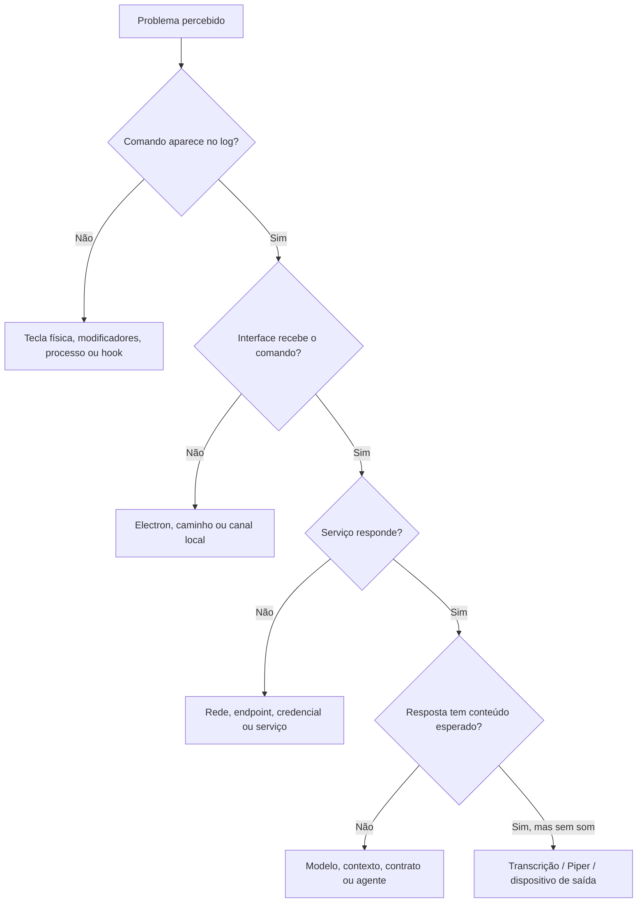

# Diagnóstico e recuperação

## Método: encontre a primeira camada que falha



Faça testes pequenos e sem efeitos externos. Não habilite o nível +3 nem envie mensagens reais para provar apenas que a API está acessível.

## Atalhos e interface

| Sintoma | O que conferir | Ação |
|---|---|---|
| Nenhum atalho funciona | Processo `global_shortcuts.py` e tarefa | Iniciar a tarefa correta; ler o log |
| Tecla escreve letras | Configuração gravada no dispositivo | Selecionar modificadores **e a tecla final**, salvar no teclado |
| Giro não muda nada | Log `autonomy-more` / `autonomy-less` | Sem registro: revisar sinal físico; com registro: verificar modo e API |
| Só chegam Ctrl/Alt/Shift | Ausência de +/− no sinal | Regravar a direção com a tecla principal ou numérica correta |
| Aumentar diminui | Mapeamento final ou configuração física antiga | Ctrl+Alt++ deve gerar `autonomy-more`; Ctrl+Alt+−, `autonomy-less` |
| Janela não abre | Electron esperado em `C:\repositorio\nino` | Instalar dependências no caminho correto; ver `control-client.log` |
| Janela fica com versão antiga | Electron não reiniciado | Fechar somente o cliente Control correspondente e reiniciar ativador |
| “Já estava rodando” | Mutex de instância única | Usar a cópia existente ou reiniciá-la; não abrir várias |
| Startup está cadastrado, mas não funciona após login | Caminho Python, usuário interativo, dependências | Ver tarefa, resultado da última execução e logs |

Leitura dos logs:

```powershell
Get-Content C:\repositorio\teclado2\macropad.log -Tail 30
Get-Content C:\repositorio\teclado2\control-client.log -Tail 30
```

Não publique o log inteiro sem revisar dados privados.

## Autonomia

### Nível parado em zero

Primeiro confira `enabled`. Em modo desligado o giro não ativa nem eleva o nível. Use A para ativar e depois ajuste. Com modo ligado, zero é apenas o centro da escala: o próximo `less` deve chegar a −1 e continuar ligado.

Se o servidor estiver ativo, mas não houver mudança confirmada, verifique resposta de rede, versão e revisões. O indicador pode estar mostrando uma solicitação pendente, não um estado persistido.

### “Estado de autonomia inválido”

O cliente valida tipos, intervalo −3…+3, revisão, validade e `scaleVersion: 2`. Uma causa observada foi manter o Electron antigo de 0…3 depois de atualizar o servidor. Atualize ambos e reinicie o processo local. Não remova a validação para esconder a incompatibilidade.

### Consulta autenticada sem alterar estado

Na instalação Nino existente, este comando lê a configuração privada em memória e imprime apenas o estado:

```powershell
$conexaoSuperhouse = Get-Content C:\repositorio\nino\data\ch8-config.json -Raw | ConvertFrom-Json
$uriSuperhouse = [Uri]::new([Uri]$conexaoSuperhouse.url, '/autonomy')
Invoke-RestMethod -Uri $uriSuperhouse -Headers @{ Authorization = "Bearer $($conexaoSuperhouse.token)" } -TimeoutSec 15 |
    Select-Object enabled,level,scaleVersion,revision,expiresAt,label,expired
```

`expired: true` indica perda do lease. Restabeleça a comunicação e ative novamente conscientemente; não force heartbeat como atalho para reautorizar. `401/403` sugere autenticação; `404` pode indicar módulo não instalado ou rota incorreta; `502/503` indica problema de encaminhamento/serviço, conforme a implantação.

### Ponte aceitou, mas agente não respondeu

Confirme o evento na rotina remota, o id/revisão recebidos, os canais efetivamente conectados e a autorização vigente. O POST do webhook não comprova execução nem entrega. Antes de reenviar uma ação, confira se a primeira já foi executada para não duplicar mensagens ou rotinas.

## Áudio e modelo

| Sintoma | Verificação |
|---|---|
| Microfone não abre em Q | Permissão do Windows, dispositivo selecionado e mensagem na interface |
| Gravação muito curta | Aguardar “Gravando”; segurar enquanto fala; soltar ao terminar |
| Erro de Whisper/PyAV | Venv correto; instalar `requirements-atom.txt`; conferir cache Windows |
| Texto transcrito, mas Control falha | Endpoint/token CH8; JSON em vez de HTML de login; rede privada |
| Resposta escrita, mas sem fala | Piper executável, voz `.onnx` e `.onnx.json`, saída e volume do PC |
| Nino não encontra modelo | API Atomic/Ollama disponível, backend correto e modelo carregado |
| Base local não encontra conteúdo | Documentos indexados, configuração RAG e suporte de embeddings do backend |
| Resposta não usa documentos da empresa | Verificar se a consulta foi ao contexto local ou ao Control; não são bases sincronizadas automaticamente |

Comandos de leitura:

```powershell
Test-NetConnection 127.0.0.1 -Port 1337
Invoke-RestMethod 'http://127.0.0.1:1337/v1/models'
Test-Path C:\repositorio\nino\vendor\sttenv\Scripts\python.exe
Test-Path C:\repositorio\nino\vendor\piper-windows\piper\piper.exe
```

Uma porta aberta não comprova que o modelo respondeu corretamente. Use uma pergunta curta, sem ações, para validar conteúdo depois da conectividade.

## Atom

- **Não conecta:** Wi-Fi 2,4 GHz, IP/URL de firmware e servidor, isolamento de clientes e firewall TCP 3082.
- **401:** chave diferente ou curta; o servidor exige pelo menos 32 caracteres.
- **409:** já existe conversa em andamento; aguarde e confira o resultado.
- **WAV inválido:** formato precisa ser mono, 16-bit, 16 kHz e tamanho válido; não altere só o cabeçalho de um áudio em outro formato.
- **Texto existe, mas não toca no Atom:** confira `output`, download `/reply/<id>`, alimentação e reprodução física.
- **Ausência oscila:** confira os heartbeats; mais de 90 s sem sinal suspende inferência, não significa que a pessoa saiu.
- **`WIFI_REASON_AUTH_EXPIRE` / motivo 2:** use os diagnósticos seriais para revisar autenticação e configuração da rede 2,4 GHz. Firmware gravado com sucesso não comprova associação Wi-Fi; confira se `lastHeartbeat` deixou de ser `null` antes de validar ausência.
- **Firmware não compila:** confirme hardware Atom Voice/ESP32-PICO-D4 e `platformio.ini`; AtomS3 é outro alvo.

Use o monitor serial a 115200 para obter a etapa da falha. Não apague a flash inteira como primeira medida.

## Placa amarela

```powershell
Invoke-WebRequest 'http://127.0.0.1:8788/health' -UseBasicParsing
(Invoke-WebRequest 'http://127.0.0.1:8788/cyd' -UseBasicParsing).Content
```

`/cyd` deve começar por `CTRL/1`. Se a tela liga e não recebe dados, confira gateway, endereço LAN no sketch, token kiosk e acesso ao Control. Se funciona no PC mas não na placa, investigue rede/firewall antes de trocar firmware.

O build LVGL usa caminhos/versionamentos Arduino15 fixos e reaproveita alguns artefatos de compilação. Falhas em uma máquina limpa podem ser de preparação de toolchain/cache; não são prova de defeito na placa. Consulte o manual específico antes de usar um comando de outra variante (`atlas_cyd`, LVGL ou upstream ESP-IDF).

Áudio do gateway da placa procura dispositivos de headset por nome. Uma instalação sem esse hardware pode precisar ajustar seleção de entrada/saída. Essa rota não compartilha automaticamente a seleção do Nino.

## Escalonamento

Registre: componente, horário, versão/commit, comando executado, estado observado, etapa que falhou e trecho mínimo de log sem segredo. Em incidentes com ações externas, registre também id/revisão e se houve entrega real. Evite repetição automática enquanto o resultado anterior for desconhecido.
