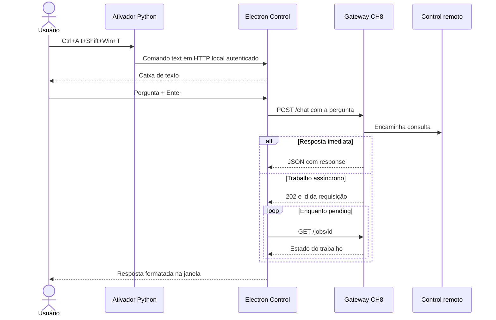
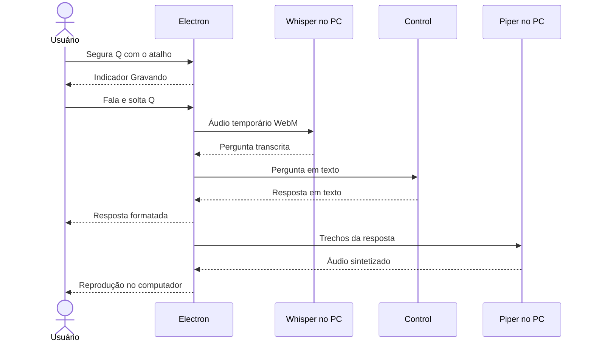
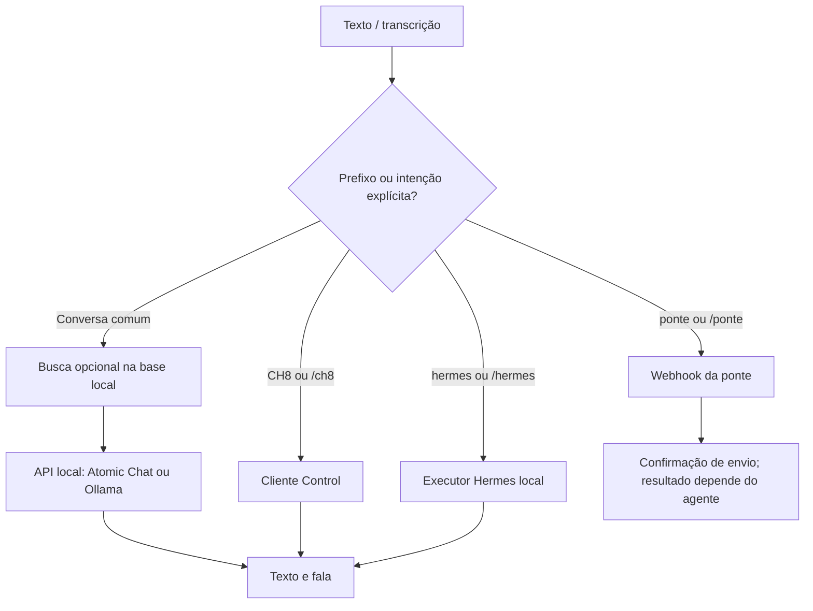
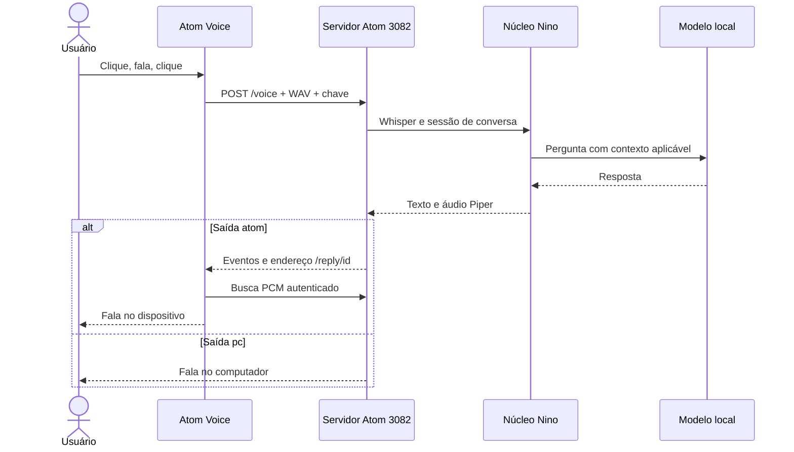
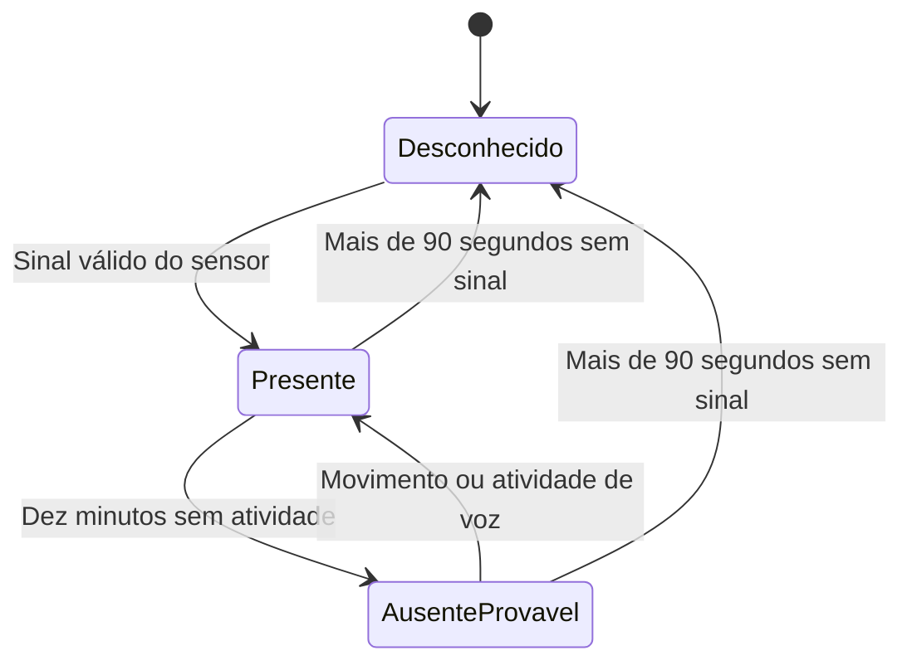
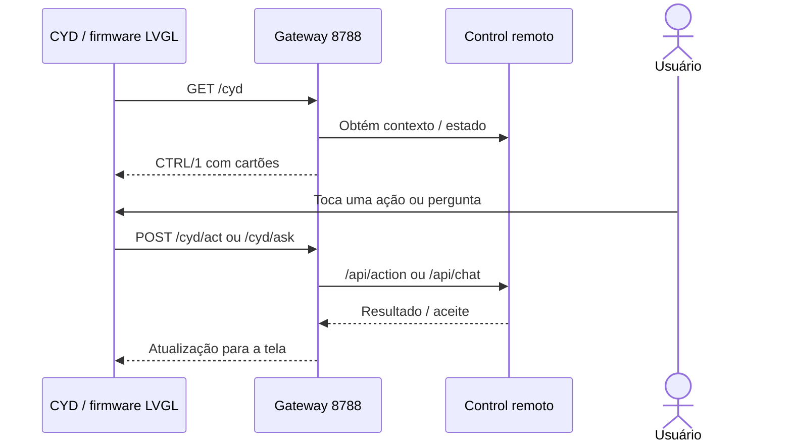
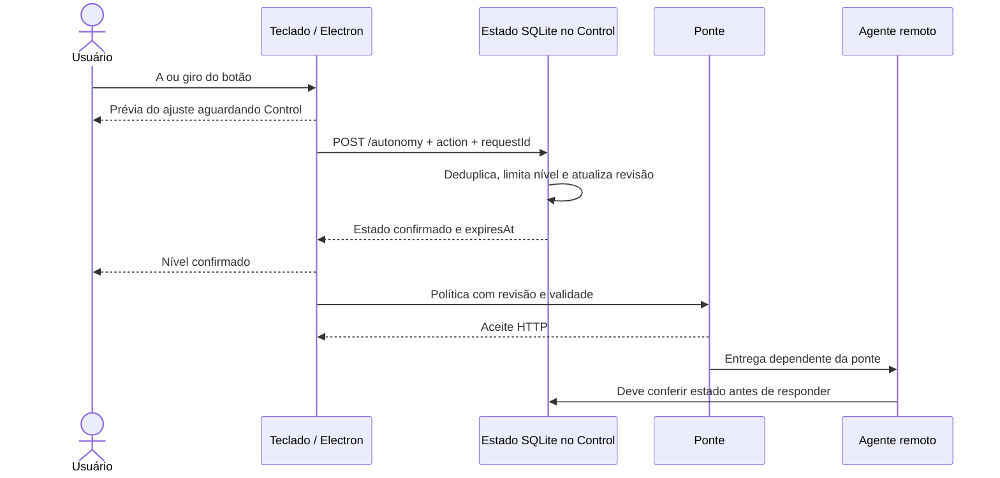

# Fluxos de funcionamento

## 1. Pergunta por texto no macropad

Enter envia; Shift+Enter insere linha. A pergunta deve ter de 1 a 8.000 caracteres. O cliente recusa resultados sem texto e páginas HTML de autenticação no lugar de JSON. O cancelamento interrompe a espera local; não é garantia de que um trabalho remoto já iniciado foi desfeito.

## 2. Pergunta por voz no macropad

O atalho Q é pressione-para-falar: a soltura de Q encerra a gravação mesmo que os modificadores tenham sido soltos antes. A interface usa o microfone do Windows pelo navegador do Electron. A duração tem proteção de dois minutos, o corpo enviado à transcrição é limitado e gravações muito curtas são recusadas. O arquivo temporário é removido ao finalizar a transcrição. A voz neural usa a configuração e os arquivos Piper do Nino; o texto é dividido para preservar respostas longas.

## 3. Conversa geral do Nino

O detector Hermes também reconhece alguns pedidos diretos de criar/agendar/executar agentes ou rotinas. Isso é uma regra de texto em `hermes.js`, não uma classificação universal de intenções. Imagens seguem a rota de visão; os prefixos remotos não são usados nessa condição.

A sessão local preserva histórico limitado. Consultas explícitas remotas usam os contratos próprios e não recebem automaticamente todos os documentos, conversas ou credenciais do Nino.

## 4. Atom Voice

O Atom tem um comportamento de botão diferente do Q: um clique inicia, outro clique envia. A proteção é de 30 segundos. O firmware envia WAV PCM mono de 16 bits a 16 kHz para `POST /voice`, autenticado.

O caminho final também pode mudar com um prefixo remoto na pergunta transcrita. A janela Electron do Nino não precisa estar aberta para o servidor usar `chat.js`. Gravações, respostas e metadados podem permanecer em `nino/data/atom/`; a retenção é responsabilidade da operação.

## 5. Sensor e ausência provável

O firmware informa movimento a cada 30 segundos e em eventos de movimento. Com sensor conectado, dez minutos sem atividade indicam ausência provável. O servidor envia uma verificação à ponte e repete a cada cinco minutos enquanto essa condição persistir. Movimento ou uso de voz encerra a intensificação.

O PIR detecta movimento, não presença humana garantida. Na versão atual, uma ausência nova solicita `sensor-absent` ao Control: se não houver modo ativo, ele pode ativar somente o nível neutro 0, com origem `sensor`. Isso não autoriza respostas automáticas a terceiros. A renovação é de 30 segundos, com lease de 90 segundos. No retorno ou desconexão, `sensor-clear` encerra apenas uma ativação ainda pertencente ao sensor. Mudanças manuais prevalecem; desligar manualmente impede reativação no mesmo ciclo de ausência.

Antes de intensificar os alertas, o monitor aguarda o estado confirmado do Control. Se ele estiver desligado ou indisponível, o evento não solicita intensificação nem alertas mobile. A implementação estendida está em `nino/scripts/control-autonomy-server.py`; reinstalar somente o módulo antigo do teclado pode remover essas ações.

## 6. Placa amarela

O firmware consulta uma representação compacta `CTRL/1` e apresenta cartões na tela. O gateway Python agrega contexto e adapta as ações locais às APIs do Control. O firmware tem endereços para LAN, Tailscale e nuvem; a existência dessas constantes não comprova disponibilidade das três rotas.

A fila de ações, o RAG remoto e a entrega por agentes dependem dos serviços externos. O gateway também possui rotas de diário e voz; sua implementação de áudio no PC é própria, em `voice_pc.py`, e não deve ser confundida com o Piper usado por Q/Atom.

## 7. Ajuste de autonomia

O indicador reage ao nível solicitado, marcado como pendente. A confirmação vem do servidor. Só então o novo estado pode ser usado como autorização.

O cliente manual envia heartbeat a cada dois minutos; a autorização manual vence após cinco minutos sem renovação. O modo pertencente ao sensor tem lease separado de 90 segundos e não é prolongado pelo heartbeat do teclado. Falha de rede não equivale a aprovação. Consulte [Operação](OPERACAO.md) para os níveis e [Configuração](CONFIGURACAO.md) para o contrato.
