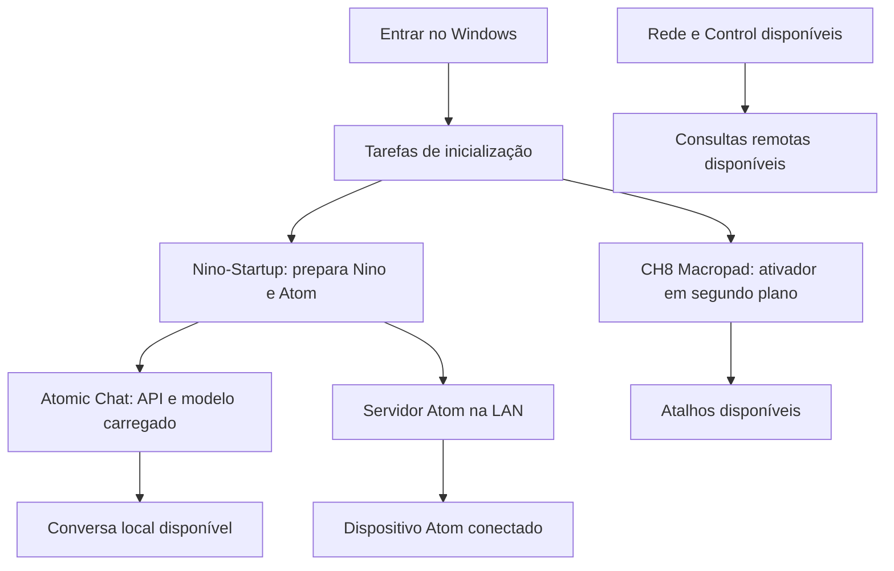

# Operação diária

## Ordem de início



Essas dependências são parciais. Abrir um site não exige o modelo local. Q/T consultam o Control, mas Q precisa de transcrição e síntese no PC. Atom usa a conversa local por padrão. O gateway CYD deve ser iniciado separadamente; ele não é registrado pelo instalador de startup do teclado.

## Atalhos finais

| Combinação | Resultado |
|---|---|
| Ctrl+G | Abre/focaliza Grok Bot |
| Ctrl+Shift+O | Abre ChatGPT Classic pelo alias configurado |
| Ctrl+Shift+K | Abre Claude |
| Ctrl+Shift+L | Abre/focaliza Cursor |
| Ctrl+Alt+H ou Ctrl+Alt+Y | Abre Nino |
| Shift+Win+C | Abre `https://control.ch8ai.com.br` |
| Shift+Win+R | Abre `https://ragpro.ch8ai.com.br/` |
| Shift+Win+K | Abre Hermes pelo atalho instalado no Windows |
| Shift+Win+Z | Abre `https://monitor.ch8ai.com.br/` e `https://chcontrol.ch8ai.com.br/` |
| Ctrl+Alt+Shift+Win+T | Caixa de pergunta por texto |
| Ctrl+Alt+Shift+Win+Q | Grava enquanto Q estiver pressionado; ao soltar, processa e fala |
| Ctrl+Alt+Shift+Win+A | Liga/desliga modo autônomo; nível inicial 0 |
| Ctrl+Alt++ | Aumenta o nível de autonomia |
| Ctrl+Alt+− | Diminui o nível de autonomia |

Q/T/A também aceitam Ctrl+Alt+Win sem Shift, conforme o sinal observado no teclado. O giratório aceita Ctrl+Alt com as teclas +/− do teclado principal ou numérico; Shift/Win adicionais não impedem o reconhecimento. **Option corresponde a Alt no Windows.** Os aliases de aplicativos são específicos da instalação e precisam existir.

Shift+Win+Z solicita a abertura de cada endereço pelo navegador padrão. A escolha de reutilizar janela/abrir abas depende das preferências do navegador; o ativador não gerencia sessões de login desses sites.

## Uso por texto e voz

**Texto:** abra T, escreva, Enter para enviar. Shift+Enter quebra linha. A resposta tem formatação de títulos, listas e código. Copiar usa o texto da resposta. Escape/fechar oculta a interface e cancela a espera corrente.

**Voz:** segure Q e aguarde o indicador “Gravando” antes de falar. Solte Q ao terminar. A sequência é transcrever, consultar, sintetizar e tocar. Um toque muito curto não é uma pergunta válida. Escolha o microfone e a saída corretos no Windows; a voz depende do Piper instalado no Nino.

Não interprete a demora de uma consulta como falta de captura de tecla. Veja o estado na janela, o log do ativador e o da interface para identificar em qual etapa houve espera.

## Níveis de autonomia

O modo tem dois eixos independentes: **ligado/desligado** e **nível de −3 a +3**. Descer para −3 não desliga. A tecla A faz a alternância; ao ativar/recomeçar, o nível é 0. Se a conexão expirar, o estado efetivo deixa de autorizar respostas mesmo que a última tela tenha mostrado um nível alto.

| Nível | Categoria | Comportamento solicitado ao agente |
|---|---|---|
| −3 | Supervisão máxima | Pedir aprovação em cada etapa, inclusive análise adicional e preparo de resposta |
| −2 | Revisão de rascunhos | Preparar rascunhos para revisão; não enviar automaticamente |
| −1 | Aprovação de resposta | Analisar e recomendar resposta; pedir aprovação antes do envio |
| 0 | Neutro | Alertar, recomendar ações e pedir intervenção; sem resposta automática a terceiros |
| +1 | Autonomia cautelosa | Responder sem aprovação quando a confiança justificada for pelo menos 95% |
| +2 | Autonomia ampliada | Responder sem aprovação quando a confiança justificada for pelo menos 85% |
| +3 | Autonomia máxima nas respostas | Responder sem aprovação prévia, declarando incertezas ou pedindo esclarecimentos |

Essas porcentagens são uma política instruída ao agente. O repositório não contém um mecanismo estatístico que prove confiança calibrada em cada resposta. Todos os níveis se restringem a fontes e canais previamente autorizados. Eles não concedem autorização para pagamentos, exclusões, mudanças de acesso ou outras decisões fora de respostas em mensagens.

### Indicador e confirmação

Ao pressionar A ou girar, um painel flutuante aparece por seis segundos, sem tirar o foco do aplicativo. O número pode mostrar a prévia do nível solicitado, explicitamente marcado como aguardando Control. O estado confirmado vem da API. Uma falha de comunicação deve mostrar indisponibilidade, não uma autorização presumida.

O indicador da interface web do Control consulta o estado a cada cinco segundos; ele não é atualizado por push. Por isso a tela web pode ficar atrás do giro por alguns segundos. O cliente local serializa os ajustes para preservar a ordem, e a rede pode aumentar o tempo de confirmação em giros rápidos.

“Evento recebido pela ponte” significa aceite HTTP. Confira no Control/agente o resultado efetivo e a entrega ao canal. Nunca assuma que um aviso de recebimento já significa uma mensagem enviada ao destinatário final.

## Atom: botão e LED

| Estado observado no firmware | Significado |
|---|---|
| Laranja | Conectando ao Wi-Fi |
| Verde | Pronto para gravar |
| Amarelo | Gravando; outro clique envia |
| Azul | Processando transcrição/consulta |
| Roxo | Reproduzindo no dispositivo |
| Vermelho | Falha; consulte serial e servidor |

Não confunda a gravação de dois cliques do Atom com o Q de segurar/soltar. O PIR não inicia gravação. Atividade de voz ou movimento também influencia o acompanhamento de ausência, sem alterar o modo autônomo manual.

Uma ausência nova pode ativar automaticamente **somente o nível neutro 0**, com origem `sensor`, quando não houver modo ativo. A ativação dura enquanto o sensor mantém seu lease de 90 segundos. O retorno ou perda do sensor limpa somente uma ativação que ainda pertence a ele; mudanças manuais sempre prevalecem. O mesmo ciclo não desfaz um desligamento manual. Essa ativação não permite respostas automáticas a terceiros.

## Estado e tarefas no Windows

```powershell
Get-ScheduledTask -TaskName 'CH8 Macropad','Nino-Startup' -ErrorAction SilentlyContinue |
    Select-Object TaskName,State
Get-ScheduledTaskInfo -TaskName 'CH8 Macropad'
Get-CimInstance Win32_Process |
    Where-Object { $_.Name -eq 'pythonw.exe' -and $_.CommandLine -like '*global_shortcuts.py*' } |
    Select-Object ProcessId,CreationDate,CommandLine
```

`CH8 Macropad` deve aparecer em execução quando o ativador está sob a tarefa. `Nino-Startup` pode terminar após iniciar os processos; “Ready” nessa tarefa não prova que Nino ou Atom pararam. Verifique os processos/portas próprios. O carregamento frio do Atomic pode levar minutos, e o orquestrador de startup tem prazo próprio.

### Iniciar ou parar o ativador

```powershell
Start-ScheduledTask -TaskName 'CH8 Macropad'
Stop-ScheduledTask -TaskName 'CH8 Macropad'
```

Se outra cópia tiver sido aberta manualmente fora da tarefa, identifique seu PID pelo comando acima antes de encerrá-la. O mutex evita duas cópias úteis: “Já estava rodando” normalmente significa que o processo existente manteve o controle, não que a instalação falhou.

Para manutenção que deve sobreviver a um novo login, desabilite temporariamente a tarefa e reabilite ao terminar:

```powershell
Disable-ScheduledTask -TaskName 'CH8 Macropad'
# Faça a manutenção e feche a instância correta.
Enable-ScheduledTask -TaskName 'CH8 Macropad'
Start-ScheduledTask -TaskName 'CH8 Macropad'
```

Não use encerramento genérico de todos os processos Python/Node/Electron: outros projetos compartilham esses executáveis. Ao trocar a versão do cliente Control, encerre também sua instância Electron específica; caso contrário o código antigo permanece em memória.

## Logs e dados

| Camada | Local |
|---|---|
| Ativador de teclas | `teclado2/macropad.log` |
| Interface Control | `teclado2/control-client.log` |
| Startup Nino/Atom | `nino/data/startup/` |
| Conversas e áudio Atom | `nino/data/atom/` |
| Gateway CYD | `companion2/firmware-cyd/gateway.log` |
| Serviço remoto | Logs `systemd` dos serviços Control existentes |

Não há rotação universal de logs/áudios. Revise retenção e espaço em disco. Alguns registros contêm perguntas, transcrições ou contexto de empresas; trate-os como dados privados.
