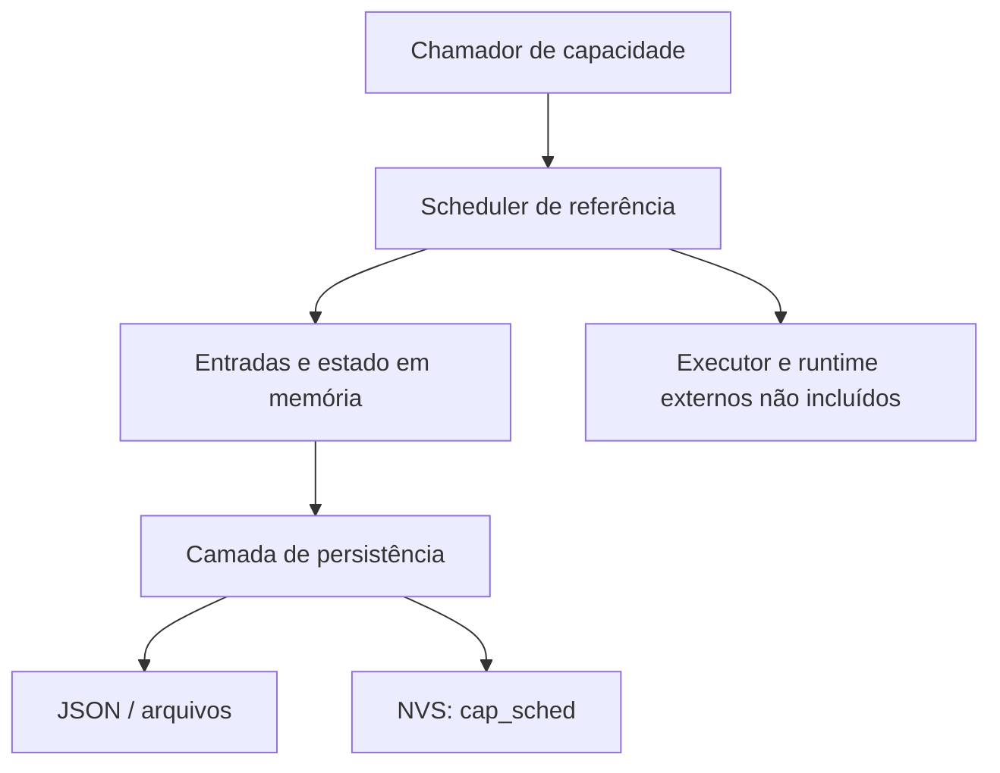

# ESPClaw

Este diretório reúne duas referências em C encontradas em `C:\repositorio\espclaw`. Elas tratam do agendador de capacidades e de seu armazenamento. Não é uma distribuição completa e compilável do ESPClaw.

Os arquivos `.bin` da origem são cópias de setores de memória e armazenamento do dispositivo; não foram incluídos por poderem conter dados e configurações privadas. Este diretório não contém um projeto completo de compilação.

## Arquivos e responsabilidades

| Arquivo | Responsabilidade observada |
|---|---|
| [cap_scheduler_reference.c](cap_scheduler_reference.c) | Registra capacidades e manipula entradas/estado do scheduler |
| [cap_scheduler_store_reference.c](cap_scheduler_store_reference.c) | Lê/grava estado, valida JSON e usa filesystem/NVS |

O scheduler declara operações como listar, obter, adicionar, atualizar, habilitar, desabilitar, remover, pausar, retomar, disparar e recarregar. Algumas capacidades são marcadas como invocáveis pelo modelo. Isso descreve o código de referência; não prova que um agente Superhouse esteja chamando essas funções em produção.

O armazenamento cria chaves NVS a partir do caminho, usa o namespace `cap_sched`, trata erros e confirma gravações com `nvs_commit`. Há também leitura/escrita de arquivos e serialização de entradas/estado em JSON. Sem as estruturas e o restante do projeto, não se deve inventar um formato de configuração nem gravar blobs diretamente no dispositivo.

## Relação com o Superhouse

O componente está organizado no mesmo repositório para manter as referências. Não foi encontrada uma rota executável que conecte esses dois arquivos ao Nino, à placa CYD ou à autonomia do teclado. Qualquer integração futura precisa de um contrato explícito de transporte, autenticação, agendamento e autoridade.

Um scheduler executar uma tarefa não equivale a ter autorização para responder mensagens de empresas. Essa regra pertence ao estado manual do Control e aos executores que o consultam, conforme a [arquitetura](../docs/ARQUITETURA.md).

## O que falta para instalar

- Projeto original e arquivos de build.
- Headers como `cap_scheduler_internal.h`, `claw_cap.h` e `claw_task.h`.
- Estruturas, executor/runtime, configurações e alvo de hardware.
- Versão compatível de ESP-IDF/FreeRTOS e bibliotecas usadas.
- Layout de partições, configuração NVS e procedimento de recuperação.
- Teste de compilação e teste físico no dispositivo correto.

Não há comando de instalação seguro e completo que possa ser deduzido apenas dessas referências. Não restaure os dumps privados em outra placa sem validar formato, tamanho, partições e credenciais. Preserve os avisos/licenças SPDX presentes nos fontes ao reutilizá-los.

## Caminho de evolução

Recupere os fontes completos, documente o hardware e rode primeiro o scheduler em um ambiente de teste. Depois defina como uma tarefa será identificada, cancelada, deduplicada e autorizada. Registre a integração nos [fluxos gerais](../docs/FLUXOS.md) somente quando o código correspondente existir.
