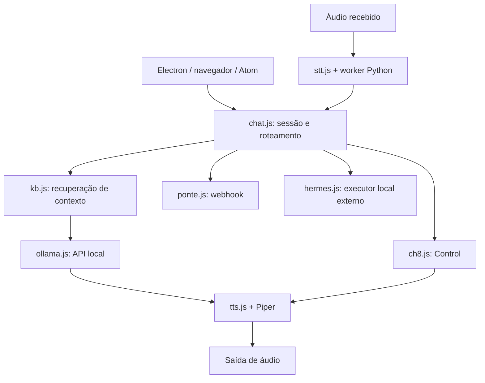

# Nino no Superhouse

## Papel do componente

O Nino é o núcleo local de conversa e voz. Ele possui interface Electron, uma interface web alternativa e módulos reutilizados pelo serviço Atom e pelo cliente Control do teclado. O mascote na tela é uma interface desse núcleo, não o único modo de executá-lo.

As funções principais são: conversar com um backend local; buscar trechos da base de documentos; transcrever áudio com Whisper; sintetizar voz com Piper; e encaminhar pedidos explícitos a Control, ponte ou Hermes. Integrações de e-mail/agenda e a triagem JEV são opcionais e usam suas configurações próprias.

## Organização interna



No desktop/web, a sessão é coordenada em `src/main/chat.js`; o servidor Atom cria sua própria sessão. As sessões não constituem uma memória universal compartilhada por todos os dispositivos. O `ollama.js` usa por padrão a API compatível do Atomic Chat, apesar do nome.

## Instalação e primeira conversa

Siga [Instalação geral](../docs/INSTALACAO.md) para Node, `npm ci`, Whisper/Piper e modelo local. Os scripts de execução presentes incluem `Nino.bat`, `Nino-Atom.bat` e os modos Atomic. Leia o script do modo escolhido se o ambiente for diferente do Windows original.

Para testar a interface sem uma integração remota:

```powershell
Set-Location C:\repositorio\nino
npm start
```

Para a interface web local:

```powershell
node src\server\web.js --host 127.0.0.1 --port 3081
```

Abra `http://127.0.0.1:3081`. Essa interface oferece acesso a funções locais; não a exponha na internet como se o binding de LAN criasse autenticação. Configure modelo e voz instalados. Teste texto antes de voz ou câmera.

Para Ollama, ajuste `OLLAMA_HOST` antes de iniciar e use a API compatível com o modo escolhido. `ATOMIC_CHAT_URL`, quando definido, tem precedência no cliente. Não use duas variáveis conflitantes esperando que a última configuração da tela sempre prevaleça.

## Base de documentos e contexto

O fluxo local pode extrair documentos e indexá-los em `data/kb`. A recuperação seleciona trechos com limite de quantidade/tamanho e informa fontes. A configuração padrão possui `useKnowledgeBase`, `topK`, `minScore`, `maxSnippet`, limites de histórico e modelo de embeddings.

Adicionar um documento não significa que ele será anexado integralmente a cada pergunta. A ausência de trechos relevantes pode ser explicitada no prompt. Uma consulta explícita ao Control não herda automaticamente esses trechos. Se a resposta depende de uma empresa, confira qual backend recebeu a consulta e onde os documentos dessa empresa foram indexados.

Documentos privados, livros, índices e gravações não estão no monorepositório. Um clone contém a implementação, não sua base de conhecimento pessoal.

## Rotas explícitas

| Entrada | Destino | Resultado esperado |
|---|---|---|
| Pergunta comum | Modelo local, com contexto local quando disponível | Texto e, conforme a interface, fala |
| `CH8: ...` ou `/ch8 ...` | Gateway configurado do Control | Texto remoto confirmado pelo contrato |
| `ponte: ...` ou `/ponte ...` | Webhook configurado | Confirmação de recebimento, não a resposta do agente |
| `Hermes: ...` ou `/hermes ...` | Adaptador Python do Hermes local | Resultado do executor, se instalado |

Pedidos diretos de criar/agendar/executar agentes ou rotinas também podem ser classificados como Hermes pela regra atual. Leia [hermes.js](src/main/hermes.js) antes de alterar essa detecção. Cancelar a espera não comprova que uma ação externa já iniciada foi cancelada; confira histórico antes de repetir.

## E-mail, agenda, visão e JEV

Os módulos Google e de caixa postal dependem de credenciais locais. A visão por câmera/tela envia a imagem ao backend configurado para visão; a afirmação de processamento local depende de ele continuar apontando para uma API local. Nenhum modelo recebe automaticamente credenciais do cofre como contexto de conversa.

JEV é triagem opcional externa. O padrão de configuração é desligado. Ao habilitar, o conteúdo selecionado para triagem pode sair da máquina, como explicado no README histórico. Não o habilite como pré-requisito de Q/T, Atom ou consulta simples local: essas funções não dependem dele.

## Atom Voice: preparação

Hardware documentado: Atom Voice / ATOM Echo C008-C, ESP32-PICO-D4, microfone SPM1423 e amplificador NS4168. Não é um alvo AtomS3/VoiceS3R. O firmware está aqui, em `firmware/atom-voice`, e não na pasta `atom2` do monorepositório.

1. Instale Whisper, Piper e o backend de modelo no PC.
2. Crie `data/atom-config.json` com IP local válido, token de pelo menos 32 caracteres e `output` desejado.
3. Copie `firmware/atom-voice/include/secrets.example.h` para `secrets.h` e preencha os valores privados correspondentes.
4. Confirme Wi-Fi 2,4 GHz, acesso da placa ao PC e regra de firewall limitada à LAN.
5. Inicie `node src/server/atom.js` ou o launcher Atom apropriado.
6. Só então compile e grave o alvo físico correto.

```powershell
python -m pip install platformio
python -m platformio run -d firmware/atom-voice
python -m platformio device list
# Use a porta USB confirmada; o comando seguinte substitui o firmware.
python -m platformio run -d firmware/atom-voice -t upload --upload-port COMx
python -m platformio device monitor --port COMx --baud 115200
```

O projeto fixa plataforma Espressif32, placa `m5stack-atom`, Arduino, FastLED e ArduinoJson em `platformio.ini`. A gravação usa armazenamento interno; o primeiro boot pode formatar a partição de arquivos. Preserve dados anteriores necessários antes do flash.

O áudio enviado é WAV mono 16-bit/16 kHz, até 30 s. O PC faz a inferência; a placa captura e reproduz. Na saída `atom`, busca a última resposta PCM autenticada. Na saída `pc`, o servidor reproduz no Windows. A rota `/speak` é destinada a mensagens faladas no PC e tem limites próprios.

## Movimento e acompanhamento

O PIR no GPIO32 informa movimento; os sinais periódicos permitem distinguir ausência provável de perda de sensor. Os tempos são 30 s de heartbeat, 90 s para considerar o sensor sem comunicação, dez minutos para ausência provável e cinco minutos entre verificações da ponte durante ausência.

Essa automação só intensifica análise/notificação. Ela não altera a autorização manual de autonomia. O agente precisa conferir o estado atual do Control antes de responder a terceiros. Uma pessoa imóvel pode ser classificada como ausente; mantenha esse limite em mente ao interpretar os alertas.

## Operação e manutenção

- Configurações e caches ficam em `data/`; ferramentas em `vendor/`.
- Startup usa `scripts/install-windows-startup.ps1` e `scripts/start-windows.ps1`.
- O orquestrador inicia Nino/Atom, aguarda o IP LAN e tenta retomar API/modelo Atomic. Não instala Hermes como serviço.
- A integração Hermes presente no código depende da instalação externa do agente; a documentação histórica que dizia não haver integração não descreve essa rota atual.
- Áudios em `data/atom/` e logs precisam de política de retenção privada.

Consulte [operação](../docs/OPERACAO.md), [diagnóstico](../docs/DIAGNOSTICO.md) e os [testes](../docs/DESENVOLVIMENTO.md). O [README original](README.md) conserva detalhes de interface e histórico; [Atom Voice](firmware/atom-voice/README.md) detalha os pinos, LEDs e limitações do dispositivo.
