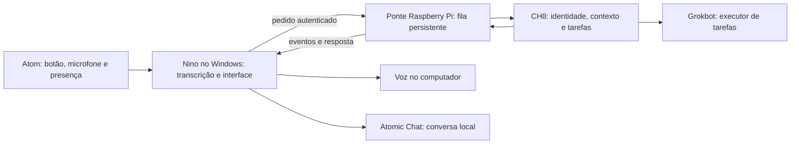

# Integração Nino, Raspberry Pi, CH8 e Grokbot

Atualizado em 10/10/2026. A conversa Nino–Control está implantada. O agente existente da ponte também está conectado por webhook, com retorno falado no Nino validado. Não foi criado um segundo agente independente.

## Arquitetura recomendada

Rotas ativas: “CH oito, …” consulta a conversa do Control; “Ponte, …” dispara a rotina do agente da ponte na nuvem, que acessa o Pi e retorna ao Nino pelo comando de voz. Perguntas sem prefixo continuam no Atomic Chat. Detalhes do webhook e do comando em `conectar-agente-ponte.md`; credenciais somente nos arquivos privados ignorados pelo Git.

Decisão após inspecionar o servidor atual: Nino conecta diretamente ao adaptador privado do Control por Tailscale. O Control já persiste a conversa e a fila; acrescentar o Raspberry ao caminho de cada pergunta duplicaria transporte sem necessidade. O Raspberry permanece como ponte opcional de dispositivos. O diagrama abaixo descreve a alternativa com ponte; a implantação atual usa Nino → Control.

A conexão direta Nino–CH8 pode ser usada se a API já oferecer fila e eventos duráveis. Nesse caso o Raspberry Pi não deve duplicar essas funções: serve apenas de conexão e recuperação. Não incluir o Grokbot no caminho de toda conversa; ele executa somente as tarefas delegadas pelo CH8.

## Responsabilidades

- Atom: capturar áudio e presença. Nenhuma credencial administrativa do CH8 no firmware.
- Nino: transcrever, exibir estados e respostas, tocar voz e encaminhar pedidos. A conversa local permanece disponível se a ponte estiver indisponível.
- Ponte: autenticar o Nino, persistir pedidos, enviar ao CH8 e recuperar resultados após desconexões. Não criar um segundo histórico oficial.
- CH8: contexto de empresa/projeto, identidade, permissões, histórico oficial e distribuição de tarefas.
- Grokbot: anunciar capacidades e receber tarefas pelo mecanismo existente de agentes, depois de verificar sua API. Não assumir compatibilidade com ferramentas ou protocolos sem inspeção.

## Fluxo de voz sem bloquear a presença

1. O Atom envia o áudio; o receptor salva e confirma o recebimento com um identificador.
2. O Atom volta a monitorar botão e presença imediatamente. A espera por Whisper, Atomic Chat ou CH8 ocorre no servidor.
3. A transcrição aparece no Nino. Para uma ação, o usuário pode conferir o texto reconhecido antes de executar.
4. Um pedido CH8 recebe identificador único; reenvios usam a mesma chave para evitar tarefas duplicadas.
5. O Nino recebe eventos de estado e o resultado, exibindo texto e reproduzindo voz no PC.
6. Reprodução no Atom é uma etapa posterior, após confirmar hardware e áudio. Exige busca separada de resultados; não manter o POST de áudio aberto até a resposta.

Estados propostos: recebido, transcrevendo, aguardando execução, executando, concluído, falhou e cancelado. São um contrato a adaptar às interfaces reais, não rotas já existentes.

## Registro do Nino como agente

Identidade sugerida: `nino-voice`. Capacidades iniciais: entrada de voz/texto, apresentação de resultados e reprodução de voz no Windows. Identificar o Windows como dispositivo executor dessas capacidades; o Raspberry Pi é o transporte, não o dono do microfone ou alto-falante.

O cadastro só deve anunciar capacidades implementadas. Consultas e tarefas devem carregar empresa, projeto, usuário, conversa, pedido e dispositivo de origem. Mensagens reconhecidas não podem escolher outra empresa por instrução do modelo.

## Ordem de implementação

1. Inspecionar API autenticada do Control, serviços da ponte e contrato de agentes do Grokbot.
2. Integrar uma consulta de leitura real, devolvendo texto e voz ao Nino.
3. Implementar pedidos assíncronos no Atom para liberar presença durante processamento.
4. Adicionar tarefas com estados, recuperação e prevenção de duplicação.
5. Registrar Nino e Grokbot nas interfaces verificadas e testar uma tarefa delegada.
6. Validar desconexão, retomada, contexto por empresa e ausência de execução duplicada.

## Evidências da inspeção

- Nino possui sessão de conversa compartilhada entre interfaces e serviço LAN do Atom; a voz no PC foi confirmada pelo usuário.
- O firmware atual espera a resposta dentro do envio de áudio. Durante essa espera não monitora presença.
- `https://control.ch8ai.com.br` respondeu HTTP 302 para `/oauth2/start`; não foi obtida uma sessão autenticada nem documentação da API.
- O servidor CH8 antigo `100.125.104.59:8081` e seu SSH não responderam às consultas desta inspeção.
- O Raspberry Pi `100.123.115.38` respondeu ao SSH, mas recusou a chave disponível para os usuários testados.
- O nó Tailscale chamado `grokbot-atomic-box` aparece offline. Isso não comprova que o serviço Grokbot não exista em outro servidor.

## Informações necessárias para implantação

Servidor privado atual do CH8; sessão ou credencial de integração com escopo apropriado; usuário e chave SSH da ponte; localização do código/serviço Grokbot. Usar configuração privada fora do Git e nunca copiar credenciais para este documento. A escolha dos endpoints depende dessas verificações.

## Inspeção autenticada em 10/10/2026

O acesso ao Raspberry Pi foi confirmado com o usuário `hudson.santos`. Nenhuma senha foi salva no projeto. Os serviços `ch8-heartbeat`, `ch8-orchestrator` e `hermes-gateway` estão ativos. O orquestrador usa `/home/hudson.santos/ch8-agent/agents/orchestrator.py`, porta 7879, autenticação Bearer e `POST /chat` com `messages` e `stream: false`, retornando JSON com `response` e `node`.

O Control configurado no Raspberry é `https://control.ch8ai.com.br`. Mesmo com o token do nó, as consultas de API testadas redirecionaram para login Google. A rota de integração entre máquinas precisa ser verificada no servidor atual; não retirar o login do painel para resolver isso.

O modelo configurado da ponte é `service-desk-qwen-3b`, provider LM Studio em `http://100.79.116.45:1234/v1`. Um teste autenticado de conversa retornou HTTP 200 em 18,1 segundos, contendo somente o aviso de fallback para Groq, sem resposta real. HTTP 200 sozinho não é prova de funcionamento da conversa.

O conector `src/main/ch8.js` e o encaminhamento em `chat.js` foram preparados. Somente mensagens iniciadas por `/ch8` ou `CH8,` são encaminhadas, sem histórico ou documentos locais. Configuração privada em `data/ch8-config.json`, ignorada pelo Git, com `enabled`, `url` (orquestrador verificado) e `token`. Não foi criada uma configuração habilitada: a autenticação dedicada, o modelo da ponte e a comunicação com o Control ainda precisam ser resolvidos. Os testes locais verificam encaminhamento, contrato, autenticação recusada e rejeição de páginas de login e avisos sem resposta.

Não foi localizado um serviço Grokbot nesta inspeção do Raspberry. O Hermes Gateway ativo não comprova equivalência com Grokbot.

## Implantação atual validada

O Control atual está em `100.119.119.83`. A API real é o serviço `control-action-inbox` em `127.0.0.1:8791`, distinto do CH8 antigo. A conversa no destino `Gemma` usa DeepSeek como primeira opção, mantendo o histórico no painel. A fila de `orquestrador` depende de outro consumidor e não foi habilitada pelo conector.

O adaptador `nino-control.service`, em `/opt/nino-ch8-gateway`, escuta exclusivamente em `100.119.119.83:8810`. A chave exclusiva fica no arquivo privado `token`; a configuração correspondente do Nino está em `data/ch8-config.json`, ignorada pelo Git. Nenhuma senha SSH foi persistida. O login Google do painel não foi alterado.

`POST /chat` retorna um identificador; `GET /jobs/{id}` informa o resultado. SQLite evita que o mesmo identificador dispare duas consultas e conserva o resultado depois de desconexões. Pedidos interrompidos por reinício são marcados como erro, sem reenvio automático que poderia duplicar ações. Há limite de oito pedidos pendentes e duas consultas simultâneas. O adaptador expõe somente conversa, estado do pedido e saúde; não expõe administração nem execução de comandos.

Uso: `/ch8 <pergunta>` no texto, ou “CH oito, <pergunta>” na voz. Respostas por voz seguem a saída já configurada no computador. Perguntas sem esse prefixo continuam no Atomic Chat. O histórico local do Nino não é enviado ao Control; o próprio Control utiliza seu histórico pessoal existente.

Teste real: o conector autenticado recebeu “Nino conectado ao Control.”. Autenticação, identificadores repetidos, validação de entrada e leitura assíncrona passaram nos testes locais. Ainda falta identificar a API do Grokbot na nuvem antes de cadastrar um agente ou afirmar que tarefas são delegadas a ele.
