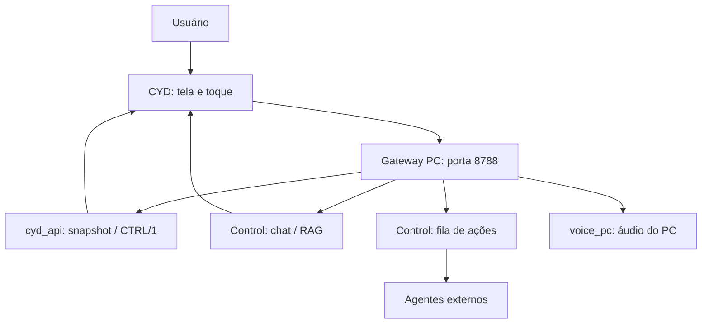

# Placa Amarela/Jarvis no Superhouse

## Qual parte usar

Este diretório reúne mais de uma experiência e uma árvore upstream com suporte genérico a muitas placas. O caminho principal da integração Control é o firmware **LVGL para CYD ESP32-2432S028R** junto ao gateway Python. Não escolha um alvo só porque ele aparece em uma pasta do upstream.

| Parte | Local | Papel |
|---|---|---|
| Firmware Control/LVGL | `companion2/firmware-cyd/atlas_lvgl/` | Tela 320×240, touch e interação com gateway |
| Gateway do PC | `companion2/firmware-cyd/placa_gateway.py` | Adapta contexto/ações/voz para Control |
| API CYD de infraestrutura | `companion2/firmware-cyd/cyd_api.py` | Monta estado da frota a partir de arquivos/serviços do servidor |
| Voz do gateway | `companion2/firmware-cyd/voice_pc.py` | Captura/reprodução no PC, com seleção de headset |
| Atlas-server | `companion2/atlas-server/` | Experimento opcional separado, não obrigatório à placa |
| Outras variantes | `atlas_cyd`, árvore `companion2/main`, dashboard Wi-Fi | Exemplos/experiências com requisitos próprios |
| Modelos de impressão | `3dprint-logos/` | Recursos de fabricação; não são serviço de IA |

## Como conversa com o resto



O gateway não é o próprio agente. Uma solicitação em `/api/action` entra no contrato do Control; seu resultado deve ser acompanhado no serviço responsável. A placa não herda automaticamente a memória do Nino. A autonomia manual é registrada pelo teclado no Control; os executores remotos precisam respeitá-la em vez de presumir que todo toque equivale a autorização ilimitada.

## Preparar o gateway

Na instalação de execução da placa:

```powershell
Set-Location C:\repositorio\placaamarelajarvis
python -m pip install requests sounddevice numpy
Set-Location companion2\firmware-cyd
python -u placa_gateway.py
```

Essas dependências correspondem ao procedimento existente do gateway/voz. Outras variantes podem exigir ferramentas adicionais. Prepare `.kiosk_token` no diretório do firmware/gateway, usando o valor da infraestrutura existente. Esse arquivo não deve entrar no Git.

Em outro terminal:

```powershell
(Invoke-WebRequest 'http://127.0.0.1:8788/cyd' -UseBasicParsing).Content
```

A resposta deve começar com `CTRL/1`. Confirme também `/health`. Uma resposta válida comprova a camada gateway, não o toque da placa nem a entrega de uma ação no agente.

O gateway escuta todas as interfaces. Limite firewall à rede necessária; não exponha 8788 diretamente à internet. Há constantes de nuvem e configuração Tailscale no código; elas pertencem à instalação original e precisam de revisão na sua rede. A implementação atual usa contexto TLS sem validar certificados: isso é uma limitação de segurança, não um requisito a copiar em uma nova implantação pública.

## Preparar o firmware LVGL

O sketch define pinos SPI, backlight e touch para o hardware CYD indicado. As constantes de rede `LAN_*`, `TS_*`, `CLOUD_*`, `WIFI_SSID` e `WIFI_PASS` ficam no sketch. Os valores Wi-Fi versionados estão vazios; configure privadamente e não commite a senha. Se mantiver uma edição local do sketch com segredo, revise o diff antes de qualquer push.

O método de build atual é específico de ambiente Windows. `_build_lvgl.py` referencia Arduino15 do usuário original, core ESP32 **3.3.12**, ferramentas específicas, partição `huge_app` e artefatos de uma compilação anterior (`core.a` e bibliotecas). Em máquina limpa, adaptar caminhos não basta se esses artefatos ainda não tiverem sido gerados.

Procedimento de preparação:

1. Confirme a placa CYD ESP32-2432S028R e o cabo USB de dados.
2. Instale a toolchain correspondente ou revise o build para a versão escolhida.
3. Confira caminhos no script, as bibliotecas locais e os artefatos que ele espera.
4. Configure rede/gateway e calibração de touch adequadas ao dispositivo.
5. Compile sem flash primeiro e resolva dependências/limite de partição.
6. Preserve firmware/dados anteriores necessários antes de gravar.
7. Grave somente a porta USB confirmada; acompanhe o boot serial.

Com o ambiente previamente preparado:

```powershell
Set-Location C:\repositorio\placaamarelajarvis\companion2\firmware-cyd
python _build_lvgl.py
# O comando seguinte substitui o firmware do dispositivo escolhido.
python _build_lvgl.py --flash COMx
```

O boot esperado pela documentação da integração inclui `BOOT CONTROL lvgl tessera`. Não use o comando Arduino de `atlas_cyd` supondo que compile a mesma aplicação LVGL. Uma instalação limpa e universal do build ainda precisa ser validada; o guia expõe essa dependência em vez de prometer um flash imediato em qualquer PC.

## Uso da tela e voz

A tela apresenta cartões derivados do Control. Toques podem reconhecer, adiar ou encaminhar ação/pergunta, conforme as rotas do gateway. O diário registra dados próprios; não publique esses arquivos junto com os fontes.

`voice_pc.py` tenta escolher headsets por nomes como soundcore/Q45 e possui lógica de voz própria. A instalação sem esse dispositivo pode usar uma seleção diferente ou precisar de adaptação. O Nino e a placa não compartilham automaticamente microfone/saída nem estado de gravação. Teste captura e reprodução do gateway separadamente do Q do teclado.

## Atlas-server opcional

```powershell
Set-Location C:\repositorio\placaamarelajarvis\companion2\atlas-server
node server.mjs
```

O padrão é localhost:8787. Ele tem motor determinístico, estado local e testes Node. Pode consultar uma API de frota configurada e possui IA opcional. A documentação própria diz que não faz parte do produto principal. Não é necessário subir Atlas para a placa exibir o Control pelo gateway 8788.

Consulte [README do Atlas](companion2/atlas-server/README.md). Não publique seu estado pessoal ou portas sem preparar autenticação e transporte apropriados.

## Diagnóstico e manutenção

Verifique, nesta ordem: gateway responde no PC; conteúdo começa por `CTRL/1`; token/contexto remoto válido; placa alcança o IP; tela/touch usam pinos e calibração corretos; ação tem resultado no Control. O log do gateway fica no mesmo diretório e pode conter conteúdo de perguntas.

A [documentação upstream](companion2/README.md) e os [protocolos](companion2/docs/websocket.md) são úteis para as respectivas variantes. Não comprovam que todas as placas listadas ali foram montadas ou homologadas no Superhouse. Para manutenção geral, leia [Diagnóstico](../docs/DIAGNOSTICO.md) e [Desenvolvimento](../docs/DESENVOLVIMENTO.md).
