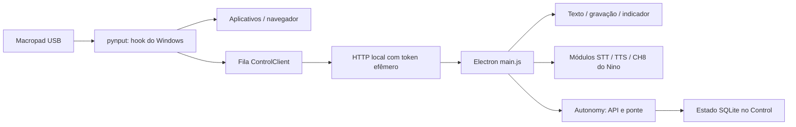

# Teclado2: macropad e interface Control

## O que este componente faz

Um processo Python escuta atalhos globais do Windows e abre aplicativos/sites ou envia comandos a uma interface Electron. Essa interface permite perguntar ao Control por texto ou voz e ajustar a autonomia dos agentes. O macropad físico deve ser programado para emitir os atalhos; o Python não regrava automaticamente o firmware/configuração do teclado.

## Arquitetura interna



`global_shortcuts.py` valida teclas/modificadores, evita repetição e usa mutex para uma instância. `control_client.py` mantém uma fila, inicia Electron quando necessário e usa porta local aleatória/token efêmero. `main.js` recebe comandos autenticados e expõe operações limitadas pela camada preload. A interface usa isolamento de contexto, sandbox e validação do remetente das operações IPC.

## Instalação

```powershell
Set-Location C:\repositorio\teclado2
python -m pip install pynput paramiko
python global_shortcuts.py
```

Para os atalhos de texto/voz, instale também o Nino no caminho esperado, com `npm ci`. Voz exige venv Whisper, modelo e Piper. A consulta remota usa `nino/data/ch8-config.json`; autonomia também usa a ponte configurada. Veja o [passo a passo completo](../docs/INSTALACAO.md), incluindo a distinção entre fonte consolidado e instalação de execução.

## Atalhos e exemplos

A tabela completa está em [Operação](../docs/OPERACAO.md). Os principais:

- Shift+Win+C abre Control.
- Shift+Win+Z abre Monitor e CHControl pelo navegador padrão.
- Ctrl+Alt+Shift+Win+T abre texto: Enter envia, Shift+Enter quebra linha.
- Ctrl+Alt+Shift+Win+Q grava enquanto Q estiver pressionado; ao soltar, transcreve, consulta e fala.
- Ctrl+Alt+Shift+Win+A alterna o modo autônomo.
- Ctrl+Alt++ aumenta; Ctrl+Alt+− diminui o nível.

Q/T/A também aceitam Ctrl+Alt+Win sem Shift. O giratório aceita as teclas principais e numéricas; não depende de Win/Shift. Option corresponde a Alt. Se o sinal vier só com modificadores, os sentidos não serão distinguíveis: configure também a tecla final e salve no dispositivo.

**Exemplo sem efeitos externos:** abra T e pergunte “Explique em uma frase como você recebeu esta consulta”. Confirme texto retornado antes de testar voz. Isso valida a rota de consulta, não o conhecimento integral das empresas.

## Autonomia e indicador

A escala vai de −3, supervisão máxima, até +3, respostas sem aprovação prévia nos canais já autorizados. Zero é neutro. A tecla A é o controle ligado/desligado; reduzir o nível não desliga. Ao ativar, o nível recomeça em 0.

O painel aparece sobre outras janelas por seis segundos e não toma foco. Ele mostra imediatamente o nível solicitado, marcado como pendente, e depois recebe o estado do servidor. A prévia não é uma autorização. Giros rápidos entram em fila e aguardam confirmação de rede.

O servidor exige `scaleVersion: 2`, mantém revisão e validade e deduplica pedidos por UUID. O cliente renova a cada dois minutos; o lease expira após cinco minutos sem renovação. O evento enviado à ponte exige conferir o estado atual antes de responder. A execução real depende dos agentes externos, que não estão integralmente implementados neste componente.

Os níveis detalhados e seus limites estão em [Operação](../docs/OPERACAO.md). O contrato está em [Configuração](../docs/CONFIGURACAO.md). Nunca use esse controle como autorização para pagamentos, exclusões ou mudanças de acesso.

## Instalação remota de autonomia

`python control/install-autonomy.py` adapta uma infraestrutura Control já existente. Precisa de SSH, hosts conhecidos, token/gateway e serviços preexistentes; modifica arquivos e reinicia serviços. Não provisiona todos os backends do Control. Senha é solicitada sem persistência.

Se precisar indicar o HTML ativo, use o arquivo absoluto `/.../index.html`. Um domínio não é um caminho do sistema de arquivos. Atualize também o cliente local e reinicie o Electron para não continuar usando código antigo em memória.

## Startup e processo em segundo plano

```powershell
powershell.exe -NoProfile -ExecutionPolicy Bypass -File .\instalar_startup.ps1
Start-ScheduledTask -TaskName 'CH8 Macropad'
```

A tarefa inicia no logon do usuário com `pythonw`, sem console, sem limite de duração, e tenta reiniciar após falha em um minuto. Não é um serviço interativo antes do login nem detecta travamento lógico de um processo que continua vivo. O caminho Python atual é fixo; revise em outra máquina.

`macropad.log` registra comandos reconhecidos; `control-client.log` registra o cliente Electron. Não encerre todos os processos Electron ou Python para atualizar apenas este componente. Identifique os processos pelo caminho do script.

## Testes e limites

```powershell
python test_nino_shortcut.py
node control/test-autonomy.js
python control/test-server-autonomy.py
python control/test-find-index.py
node control/run-ui-test.js
```

Os testes de teclado simulam sinais e confirmam combinações/repetição; os de interface usam serviços simulados. Testes não substituem gravar a configuração física, conferir abas no navegador, calibrar áudio e validar o startup após login real. Arquivos AHK/configuradores antigos foram preservados como referências; não execute vários mapeadores em paralelo.

Leia também [CONTROL.md](CONTROL.md), [diagnóstico geral](../docs/DIAGNOSTICO.md) e [manutenção](../docs/DESENVOLVIMENTO.md).
